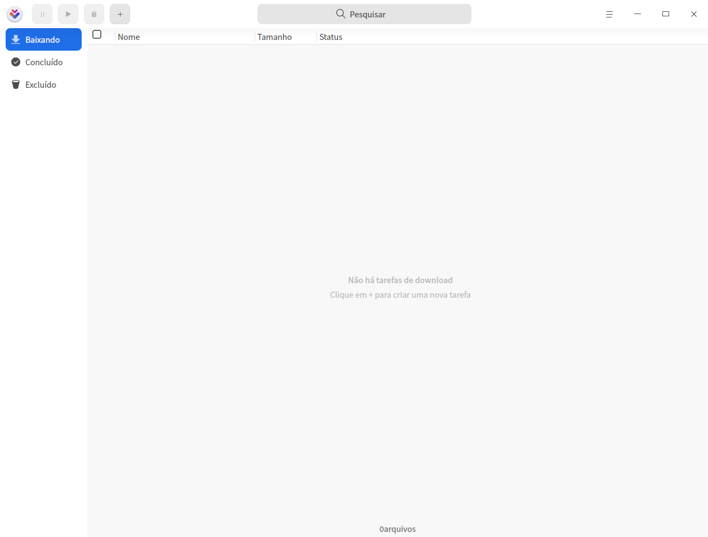
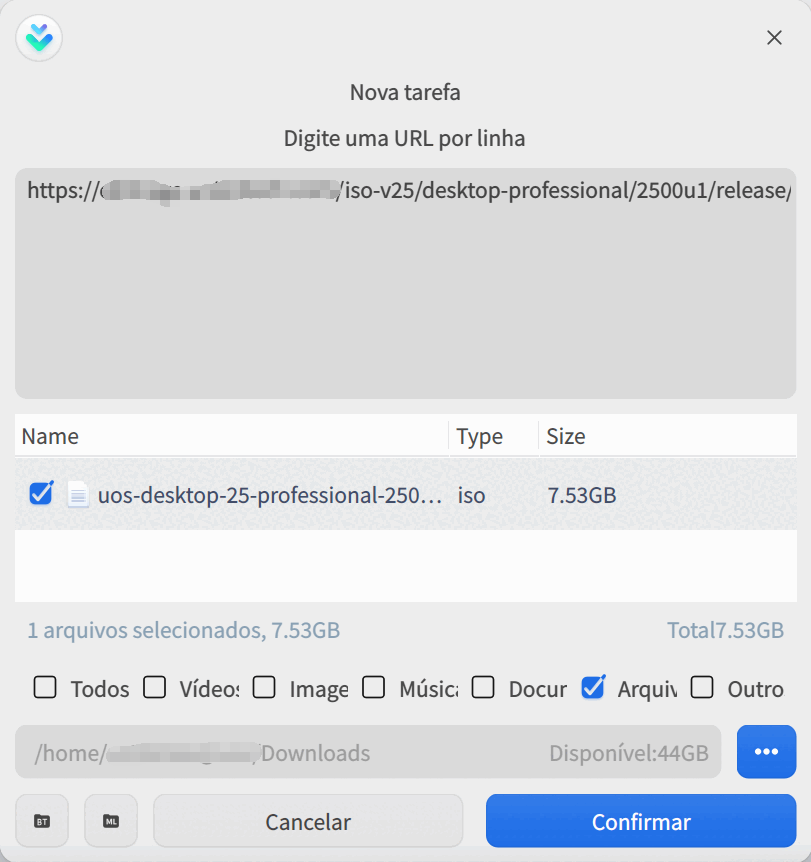
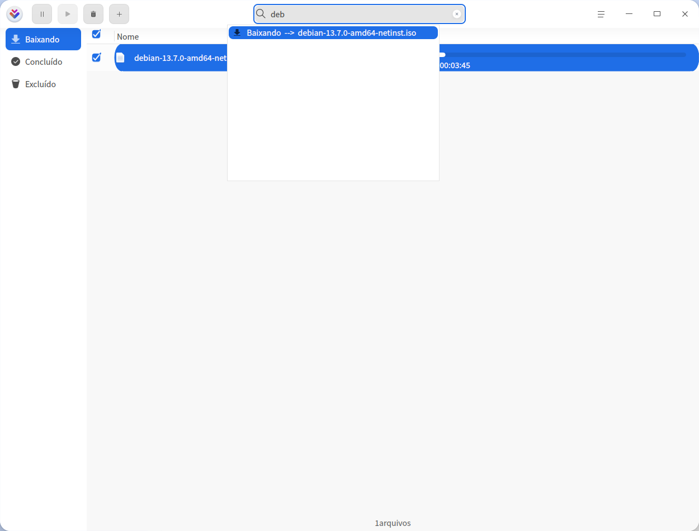
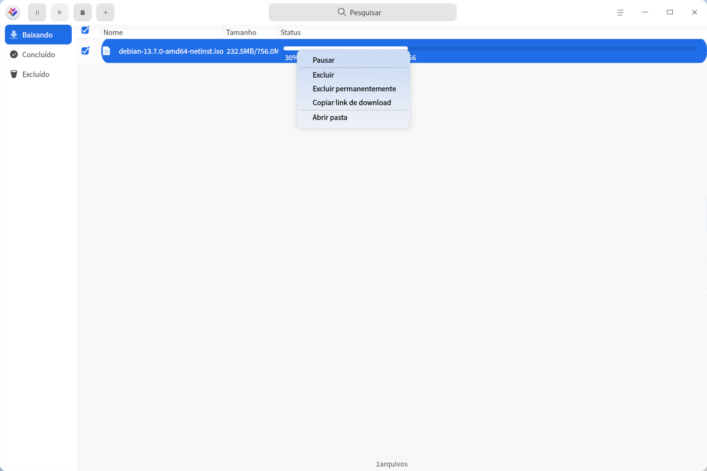
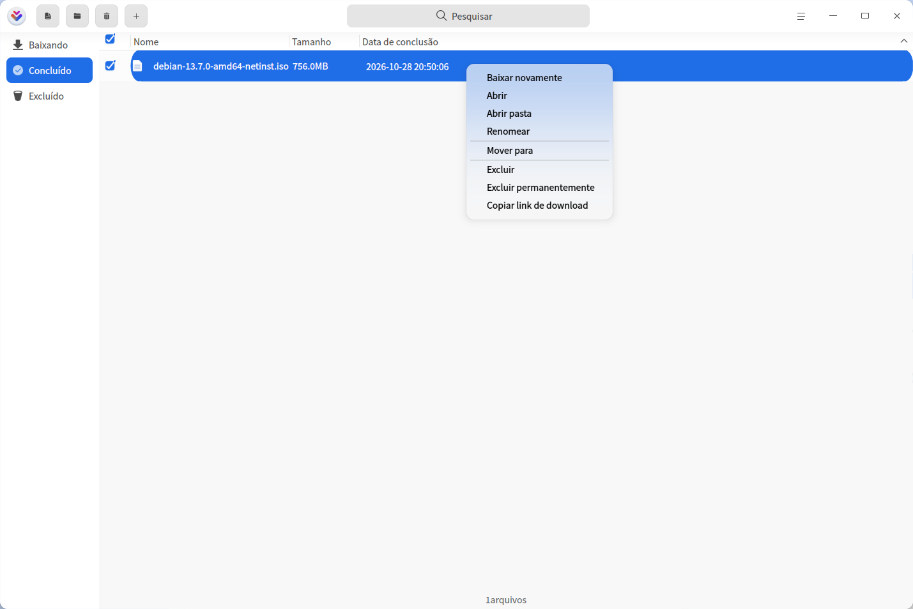
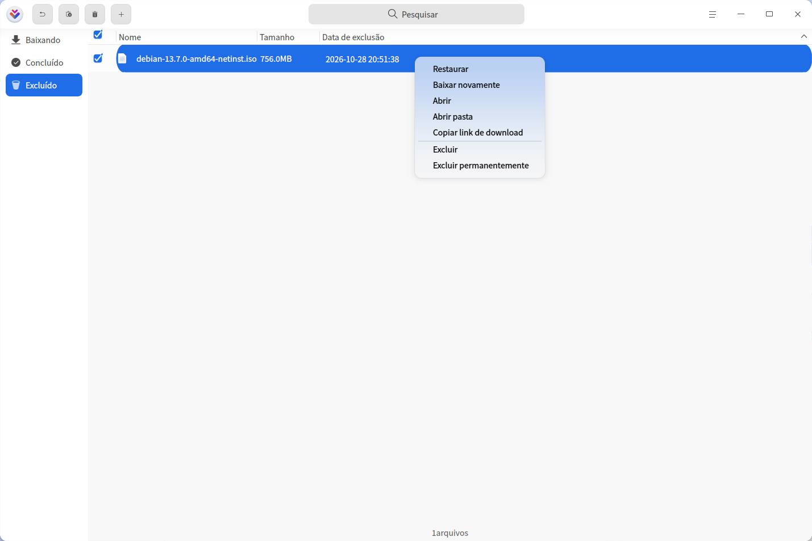

# Gerenciador de Downloads|downloader|

## Visão geral

O Gerenciador de Downloads é uma ferramenta simples e prática para baixar recursos da rede, com suporte a vários protocolos de download.

## Primeiros passos

Você pode iniciar ou fechar o Gerenciador de Downloads das formas a seguir e também criar um atalho.

### Iniciar o Gerenciador de Downloads

1. Clique no ícone do Iniciador  na barra de tarefas para abrir o Iniciador.
2. Role a roda do mouse ou use a pesquisa para localizar o ícone do Gerenciador de Downloads  e clique nele para iniciar.
3. Clique com o botão direito em  para:
   - Clicar em **Enviar para a área de trabalho** e criar um atalho na área de trabalho.

   - Clicar em **Enviar para a barra de tarefas** e fixar o aplicativo na barra de tarefas.

   - Clicar em **Iniciar na inicialização** e adicionar o aplicativo aos itens de inicialização, para que ele seja executado ao ligar o computador.

### Fechar o Gerenciador de Downloads

- Na interface do Gerenciador de Downloads, clique em  para sair.
- Clique com o botão direito no ícone  da barra de tarefas e selecione **Fechar tudo** para sair.
- Na interface do Gerenciador de Downloads, clique em  e selecione **Sair** para sair.

## Operações
### Adicionar tarefa

#### Adicionar tarefa por link de download

1. Na interface do Gerenciador de Downloads, clique no botão de adicionar tarefa  para abrir a janela **Nova tarefa**.

   

2. Informe o endereço de download, selecione o arquivo, o tipo e o diretório de armazenamento e clique em **Confirmar**; a tarefa é criada.

   > Observação: ao adicionar vários links ao mesmo tempo, garanta que haja apenas um link por linha.

#### Criar tarefa por arquivo torrent

1. Há três formas de criar uma tarefa por arquivo torrent:

   - Ao clicar duas vezes no arquivo torrent, a janela **Nova tarefa** é aberta. Se a opção "Associar arquivos torrent" estiver desativada nas configurações do menu principal, o clique duplo no arquivo torrent não cria a tarefa.
   - Na janela **Nova tarefa**, arraste o arquivo torrent até a caixa de endereço.
   - Na janela **Nova tarefa**, clique em  para abrir o gerenciador de arquivos e escolher o arquivo torrent desejado.
2. Selecione o arquivo, o tipo e o diretório de armazenamento e clique em **Confirmar**; a tarefa é criada.

#### Criar tarefa por arquivo Metalink

1. Há três formas de criar uma tarefa por arquivo Metalink:

   - Ao clicar duas vezes no arquivo Metalink, a janela **Nova tarefa** é aberta. Se a opção "Associar arquivos Metalink" estiver desativada nas configurações do menu principal, o clique duplo no arquivo Metalink não cria a tarefa.

   - Na janela **Nova tarefa**, arraste o arquivo Metalink até a caixa de endereço.
   - Na janela **Nova tarefa**, clique em  para abrir o gerenciador de arquivos e escolher o arquivo Metalink.

2. Selecione o arquivo, o tipo e o diretório de armazenamento e clique em **Confirmar**; a tarefa é criada.

### Pesquisar tarefas

Na interface do Gerenciador de Downloads, clique no botão de pesquisa  e digite uma palavra-chave para localizar as tarefas de download relacionadas.

### Baixando

Consulte a lista de tarefas em andamento, incluindo nome, tamanho e status. Também é possível operar as tarefas marcadas; a seguir são apresentadas as operações de uma tarefa individual.

>  Observação: as operações disponíveis para uma tarefa e para várias tarefas marcadas são diferentes; considere a situação real.

**Pausar**: clique no botão de pausa  ou clique com o botão direito e selecione **Pausar** para interromper o download.

**Retomar**: para continuar o download, clique no botão de iniciar  ou clique com o botão direito e selecione **Retomar**; o download pausado é retomado.

**Prioridade de download**: se o número de tarefas em andamento for maior que o número máximo definido, apenas as tarefas que ainda não começaram (em fila ou pausadas) terão a opção "Prioridade de download". Para saber como definir o número máximo de tarefas, consulte [Gerenciamento de tarefas](#tarefas).

**Excluir**: clique no botão de excluir  ou clique com o botão direito e selecione **Excluir**; a tarefa em andamento é removida e movida para a lixeira. Se **Excluir arquivos locais** estiver marcado, o arquivo local também é excluído.

**Excluir permanentemente**: clique com o botão direito e selecione esta opção para excluir definitivamente a tarefa marcada; o arquivo local também é excluído.

**Copiar link de download**: clique com o botão direito e selecione esta opção para copiar o link de download.

**Abrir pasta**: clique com o botão direito e selecione esta opção para abrir a pasta do arquivo baixado.

### Concluído

Consulte a lista de downloads concluídos, incluindo nome do arquivo, tamanho e hora de conclusão. Também é possível operar as tarefas marcadas; a seguir são apresentadas as operações de uma tarefa individual.

> Observação: as operações disponíveis para uma tarefa e para várias tarefas marcadas são diferentes; considere a situação real.

**Baixar novamente**: clique com o botão direito e selecione esta opção para baixar o arquivo novamente e excluir o arquivo anterior.

**Abrir**: clique no botão abrir  ou clique com o botão direito e selecione **Abrir** para abrir o arquivo.

**Abrir pasta**: clique no botão abrir pasta  ou clique com o botão direito e selecione **Abrir pasta** para ir até a pasta do arquivo.

**Renomear**: clique com o botão direito e selecione esta opção para renomear o arquivo baixado.

**Mover para**: clique com o botão direito e selecione esta opção para mover o arquivo baixado para a pasta indicada.

**Excluir**: clique no botão de excluir  ou clique com o botão direito e selecione **Excluir**; o arquivo baixado é removido e movido para a lixeira. Se **Excluir arquivos locais** estiver marcado, o arquivo local também é excluído.

**Excluir permanentemente**: clique com o botão direito e selecione esta opção para excluir definitivamente a tarefa marcada; o arquivo local também é excluído.

**Copiar link de download**: clique com o botão direito e selecione esta opção para copiar o link de download.

### Falha no download

Quando o download de um arquivo falhar, tente baixar novamente. Se falhar outra vez, pode ser um problema no link de download, espaço insuficiente no diretório de armazenamento ou ausência de rede; considere a situação real.

### Excluído

Consulte a lista de arquivos excluídos, incluindo nome do arquivo, tamanho e data de exclusão. Também é possível operar as tarefas marcadas; a seguir são apresentadas as operações de uma tarefa individual.

> Observação: as operações disponíveis para uma tarefa e para várias tarefas marcadas são diferentes; considere a situação real.

**Restaurar**: clique no botão restaurar  ou clique com o botão direito e selecione **Restaurar**; o arquivo excluído é restaurado e movido para a lista Concluído.

**Baixar novamente**: clique com o botão direito e selecione esta opção para baixar o arquivo novamente.

**Abrir**: clique com o botão direito e selecione esta opção para abrir o arquivo.

**Abrir pasta**: clique com o botão direito e selecione esta opção para ir diretamente até a pasta do arquivo.

**Copiar link de download**: clique com o botão direito e selecione esta opção para copiar o link e baixar o arquivo novamente ou compartilhá-lo com outras pessoas.

**Excluir**: clique no botão de excluir  ou clique com o botão direito e selecione **Excluir** para remover o arquivo da lixeira. Se **Excluir arquivos locais** estiver marcado, o arquivo local também é excluído.

**Excluir permanentemente**: clique com o botão direito e selecione esta opção para excluir definitivamente a tarefa marcada; o arquivo local também é excluído.

**Esvaziar**: clique no botão esvaziar  para limpar todos os arquivos da lixeira.

## Menu principal

No menu principal é possível ajustar as configurações de download, usar a ferramenta de diagnóstico, alternar o tema da janela e consultar o manual de ajuda.

### Configurações
#### Básico

**Inicialização**: define os itens relacionados à inicialização do programa.

- Inicialização automática: com esta opção ativada, o Gerenciador de Downloads é iniciado automaticamente ao ligar o computador.
- Retomar download na inicialização: com esta opção ativada, sempre que o Gerenciador de Downloads for iniciado, as tarefas não concluídas da lista Baixando são retomadas automaticamente.

**Diretório de download**: define os itens relacionados ao diretório de download.

- Diretório padrão: escolha uma pasta no gerenciador de arquivos como caminho padrão de download; a partir de então, toda nova tarefa de download usa esse caminho como padrão.
- Último diretório utilizado: ao criar uma tarefa de download, o caminho padrão é o último diretório escolhido no download anterior.

**Download com 1 clique**: com a opção **Criar diretamente as tarefas** ativada, ao clicar em um link de download ou abrir um arquivo torrent, a interface do Gerenciador de Downloads não é exibida e a tarefa é criada diretamente.

**Fechar janela principal**:

- Selecione **Minimizar para a bandeja do sistema** para ocultar o aplicativo na bandeja do sistema ao fechar a janela principal.
- Selecione **Sair** para encerrar o aplicativo ao fechar a janela principal.
- Selecione **Perguntar sempre** para exibir uma caixa de confirmação a cada fechamento da janela principal.

#### Tarefas

Define as opções das tarefas de download, como o número máximo de tarefas simultâneas, abrir automaticamente ao concluir e mover downloads lentos para o fim da fila.

#### Downloads

**Download Management**: define o número de threads do endereço original. O limite global de recursos baixados ao mesmo tempo vem definido em 500 e pode ser ajustado na opção **Limitar número máximo de recursos para downloads**.

**Speed Settings**: escolha **Velocidade máxima** ou **Velocidade limitada**. No modo limitado, é possível definir **Velocidade máxima de download**, **Velocidade máxima de upload** e o **Período limite** (de … às …).

#### Monitorando

**Aplicativos**: os objetos monitorados são **Área de transferência** e **Navegador** e só entram em vigor com a chave ativada. Quando um link de download é copiado para a área de transferência ou um link é clicado no navegador, o Gerenciador de Downloads é iniciado e cria a tarefa automaticamente.

**Links Monitorados**: só pode ser ajustado quando há objetos monitorados. Os tipos suportados são **HTTP**, **Metalink**, **BitTorrent** e **Link magnético**. A tarefa só é criada quando o link copiado ou clicado for do tipo marcado.

Clique em **Avançado** ao lado de **HTTP** para editar as extensões de arquivo e os sites não monitorados.

**Arquivos de BT**: a opção **Criar uma nova tarefa quando um arquivo de torrent for baixado** vem desativada por padrão; quando ativada, ao baixar um arquivo torrent, o Gerenciador de Downloads é iniciado e cria a tarefa automaticamente. A associação de arquivos torrent vem ativada por padrão: ao clicar duas vezes em um arquivo torrent, a janela **Nova tarefa** é aberta para escolher o tipo de arquivo.

**Arquivos de Metalink**: a lógica é a mesma dos arquivos de BT. Com a criação automática ativada, ao baixar um arquivo Metalink, o Gerenciador de Downloads é iniciado e cria a tarefa; a associação vem ativada por padrão e o clique duplo abre a janela **Nova tarefa**.

#### Notificações

Quando o status de uma tarefa muda, uma notificação do sistema informa o conteúdo da alteração. Para detalhes, consulte [Configurações de notificação](dman:///dde#notificacoes).

#### Avançado

**Cache**: define o tamanho do cache de disco do download. Quanto maior o cache, mais rápida a velocidade de download e maior o consumo de recursos do computador.

#### Restaurar padrão

Clique em **Restaurar padrão** para restaurar as configurações padrão.

### Quando concluído

Ao concluir o download, é possível escolher **Desligar**, **Suspender** ou **Sair**. Por exemplo, para evitar o horário de pico da rede, você pode criar a tarefa antes de sair do trabalho e definir o desligamento automático ao concluir o download.

### Ferramenta de diagnóstico

Verifica o suporte ao protocolo IPv6, o status da rede DHT, as informações das tarefas de download e o ambiente de rede.

### Tema

O tema da janela inclui tema claro, tema escuro e tema do sistema.

1. Na interface do Gerenciador de Downloads, clique em .
2. Clique em **Tema** e escolha uma cor de tema.

### Ajuda

1. Na interface do Gerenciador de Downloads, clique em .
2. Clique em **Ajuda** para consultar o manual do Gerenciador de Downloads e conhecer melhor o produto.

### Sobre

1. Na interface do Gerenciador de Downloads, clique em .
2. Clique em **Sobre** para ver a versão e a apresentação do produto.

### Sair

1. Na interface do Gerenciador de Downloads, clique em .
2. Clique em **Sair**.
